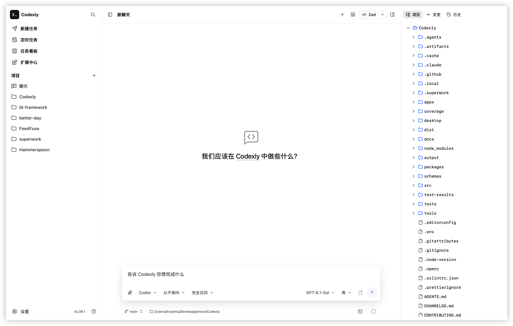

<p align="center">
  
</p>

<h1 align="center">Codexly</h1>

<p align="center">A local AI coding workspace for Codex and Claude, on desktop, the Web, and mobile browsers.</p>

<p align="center">
  <a href="https://github.com/BryanHoo/Codexly/releases">Download desktop</a> ·
  <a href="#quick-start">Quick start</a> ·
  <a href="./docs/README.md">Documentation</a> ·
  <a href="./README.md">简体中文</a>
</p>

Codexly brings AI conversations, coding tasks, project files, changes, and Git into one workspace. Work on your computer, or follow progress, answer questions, and continue tasks from a phone or tablet on the same trusted network.

Projects and agent processes run on the computer hosting Codexly. Your phone needs no coding environment. Model requests and relevant context are still sent to the model service you configure.



## Choose how to use it

| Client  | Best for                                                                                         | Get started                                                                                                                              |
| ------- | ------------------------------------------------------------------------------------------------ | ---------------------------------------------------------------------------------------------------------------------------------------- |
| Desktop | Daily local development with a project terminal, global shortcuts, and system tray               | [Download for macOS, Windows, or Ubuntu](https://github.com/BryanHoo/Codexly/releases) · [Installation](desktop/docs/installation.en.md) |
| Web     | Working in a computer browser or hosting a workspace on your LAN                                 | Install Node.js 24+ and [start the Web server](#web)                                                                                     |
| Mobile  | Following tasks, approving tools, and reviewing files and changes from a phone or tablet browser | Connect to a Web server with LAN access enabled; see [Mobile](#mobile)                                                                   |

Desktop supports Windows 10/11 x64, Ubuntu 24.04+ x64, macOS 14.5+ on Apple Silicon or Intel. Packages include agent runtimes, with no separate Node.js or Bun installation. Mobile uses a touch-friendly Web interface and requires no separate app.

## What you can do

- **Work with Codex or Claude**: configure either independently, or configure both and choose an engine for each new task. Existing tasks keep their engine.
- **Follow execution**: see streaming replies, commands, tools, plans, and file changes. Respond to approvals and questions above the composer, steer running work, or queue follow-up messages persistently.
- **Refine and reuse prompts**: optimize a nonempty text draft with AI, save project todos or prompts from the Send menu, and share prompts across desktop, Web, and mobile browsers on the same host.
- **Reuse earlier questions**: edit a user message into the current composer and send it as a new message. View available Codex session memory summaries in the context panel.
- **Read long conversations**: sending focuses the new question, scrolling preserves your reading position, and optional sticky messages and navigation anchors help you revisit content. Preview cited sources and open operation or subagent details on demand.
- **Organize projects and tasks**: browse by project or timeline, pin, archive, or restore conversations, clean up archived tasks by date, and export complete conversations as JSON. Follow task activity and open tasks, the task board, and schedules from the sidebar.
- **Work in parallel**: open up to four task panes in the desktop app or a computer browser, drag to swap their positions, and keep independent drafts and queues. Mobile uses a single-task view.
- **Read and edit project files**: create files and folders in the project tree, browse code, Markdown, images, and PDFs, and edit supported text with manual saving, search and replace, and disk conflict comparison. Reorder, pin, or bulk-close document tabs and compare files with chat. Attach files and images or reference project files. LAN devices can download files that cannot be previewed through an explicit prompt.
- **Reuse saved instructions**: save global or project prompts and insert them by title with `/` or `#`.
- **Complete Git work**: review diffs and history, manage branches and worktrees, commit selected files, commit and push, or push existing commits. Discard changes to one file or a selected batch after confirmation.
- **Configure agents**: use the model and permission options returned by the official ACP adapter. Defaults and current session settings are stored separately.

Drop files and images onto a task pane to attach them to that pane independently. Switching between chat and document tabs preserves reading positions. Desktop also renders Mermaid diagrams on demand.

Web and desktop execute through official ACP adapters and restore the original sessions. Available actions follow the implemented ACP capabilities; extension management, forks, dedicated compaction, live steering, and other unsupported engine-specific interfaces have no entry points. See [capability boundaries](docs/agent-engines.md).

File diffs expand as individual cards during streaming and move into execution history when the turn ends. Disable **Settings → General → Editor → Show file diffs separately** to restore the end-of-turn summary.

Relative links in file previews open from the current file’s directory, making project documents and Skill references easier to follow. Choose **Open remote repository** from the project quick-open or root directory menu to visit its repository in a browser; the action is disabled when no browsable remote is available.

Choose system, direct, or custom HTTP/HTTPS/SOCKS5 proxy mode in **Settings → Application → Network**, then restart the desktop app or Web server. Configuration is shared on the same host; mobile settings control the server’s outbound connections. See [Network proxy (中文)](docs/network-proxy.md).

## Quick start

### Desktop

1. Download the package for your system and architecture from [Releases](https://github.com/BryanHoo/Codexly/releases).
2. Install and open Codexly. Configure Codex, Claude, or both in Settings; supported existing local configurations can be reused.
3. Add a project folder, create a task, and send your request.

For Windows portable builds, extract the entire ZIP and keep the executable, Claude host, and `runtime` directory together. See [installation, updates, and uninstall](desktop/docs/installation.en.md).

### Web

On a computer with **Node.js 24+**, run:

```bash
npx --package @bryanhu/codexly@latest codexly start
```

The browser opens automatically. Otherwise, use the address printed in the terminal, normally `http://127.0.0.1:3210`. Keep the terminal running; press `Ctrl+C` to stop. Complete agent setup on first use, then add a project.

For regular use, install globally:

```bash
npm install --global @bryanhu/codexly@latest
codexly
```

See the [Web guide](docs/web.en.md) for options, background startup, and updates.

### Mobile

On the computer hosting your projects, run:

```bash
npx --package @bryanhu/codexly@latest codexly start --lan
```

Connect your phone or tablet to the same trusted LAN. Open the printed LAN address in its browser and enter the access password. Files, Git credentials, and agent settings belong to the host computer, which must remain awake with the service running.

LAN mode uses HTTP: use it only on trusted networks and never expose it directly to the internet. The desktop app does not host mobile connections; start the Web server for mobile access. See [mobile and LAN access](docs/web.en.md#mobile-and-lan-access).

## Connect Codex and Claude

| Agent  | Connection                                                                                                                                                                 |
| ------ | -------------------------------------------------------------------------------------------------------------------------------------------------------------------------- |
| Codex  | Sign in with ChatGPT, or configure an OpenAI-compatible service supporting the Responses API and a model list                                                              |
| Claude | Reuse supported local Claude Code credentials, or configure a service supporting the Anthropic Messages API and `/v1/models`; in-app Claude account login is not available |

Claude-only setups do not require Codex. Model availability, usage limits, and charges depend on your account or provider; Codexly does not include model credits. Desktop uses local settings; Web and mobile use settings on the Web host.

## Documentation and help

- [Documentation index](docs/README.md): installation, usage, configuration, and troubleshooting.
- [First task](docs/getting-started.en.md): connect an agent and start working.
- [Workspace guide](docs/usage.en.md): conversations, panes, files, Git, extensions, and schedules.
- [Web guide](docs/web.en.md): startup, mobile connections, and updates.
- [FAQ (中文)](docs/faq.md): storage, cross-client use, connections, and updates.
- Export an integrated diagnostic ZIP from **Settings → About** on every client, including available native Codex diagnostics by default. Review its contents before sharing; see the [diagnostic guide (中文)](desktop/docs/diagnostics.md).
- [Changelog](CHANGELOG.md) · [Issues](https://github.com/BryanHoo/Codexly/issues) · [Security](SECURITY.md)
- [Contributing](CONTRIBUTING.md): development, verification, and releases.

Thanks to the [LinuxDO](https://linux.do/) community for their support.

## License

[MIT](LICENSE)
