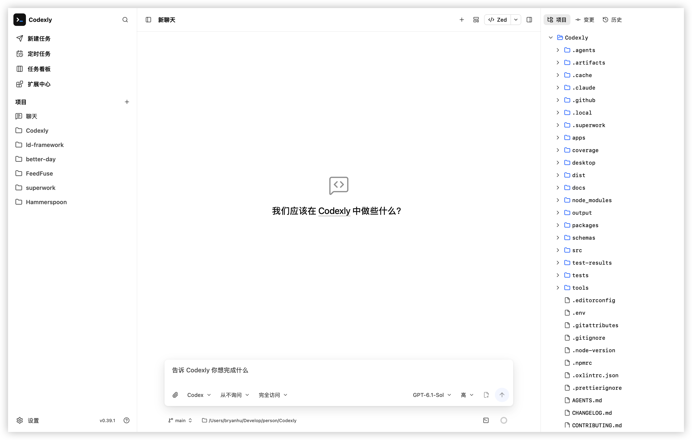

<p align="center">
  
</p>

<h1 align="center">Codexly</h1>

<p align="center">支持 Codex 与 Claude 的本地 AI 编程工作台，在桌面、Web 和手机浏览器中处理项目。</p>

<p align="center">
  <a href="https://github.com/BryanHoo/Codexly/releases">下载桌面版</a> ·
  <a href="#快速开始">快速开始</a> ·
  <a href="./docs/README.md">使用文档</a> ·
  <a href="./README.en.md">English</a>
</p>

Codexly 将 AI 对话、编程任务、项目文件、代码变更与 Git 操作集中在一个工作台。你可以在电脑上持续开发，也可以从同一可信局域网中的手机或平板查看进度、回答问题和继续任务。

项目文件与智能体在运行 Codexly 的电脑上处理；手机无需安装编程环境。使用模型时，相关请求与上下文仍会发送给你配置的模型服务。



## 选择你的使用方式

| 使用端 | 适合的场景                                                       | 开始方式                                                                                                                    |
| ------ | ---------------------------------------------------------------- | --------------------------------------------------------------------------------------------------------------------------- |
| 桌面端 | 在本机长期开发，使用集成终端、全局快捷键、独立任务窗口与系统托盘 | [下载 macOS、Windows 或 Ubuntu 版](https://github.com/BryanHoo/Codexly/releases) · [安装指南](desktop/docs/installation.md) |
| Web 端 | 在电脑浏览器中使用，或让一台电脑提供局域网工作台                 | 安装 Node.js 24+ 后[启动 Web 服务](#web-端)                                                                                 |
| 移动端 | 在手机、平板浏览器中跟进任务、审批工具操作、查看文件与变更       | 连接已开启局域网访问的 Web 服务，见[移动端连接](#移动端)                                                                    |

桌面版支持 Windows 10/11 x64、Ubuntu 24.04+ x64、macOS 14.5+（Apple Silicon / Intel），另有 macOS 12.4+ Intel Legacy 版。安装包内置智能体运行时，无需另装 Node.js 或 Bun；Legacy 仅支持 Codex。移动端使用适配小屏和触屏的 Web 界面，无需单独安装 App。

## 你可以用它做什么

- **用 Codex 或 Claude 处理项目**：独立配置任一引擎，也可同时配置并在新任务中选择；已有任务保留原引擎。
- **跟进执行过程**：实时查看回复、命令、工具调用、计划与文件变更，在输入框上方处理审批和问答；为运行中的任务补充要求，或将后续消息加入持久队列。
- **阅读长对话**：发送后定位到新问题，向上阅读时保留位置并通过吸顶摘要回看；连续操作使用五行摘要窗口，详情按需打开。
- **组织多项目任务**：按项目或时间线浏览，置顶、归档或恢复对话，按日期清理归档任务，导出完整对话 JSON；通过通知中心处理提醒或清理已读通知，从侧栏打开任务看板、扩展与定时任务。
- **并行推进工作**：桌面应用和电脑浏览器支持最多四个任务分屏，可拖动交换位置，各自保留草稿与消息队列；移动端使用单任务视图。
- **查看与修改项目文件**：浏览和编辑支持的文件，拖动排序、固定或批量关闭文档标签，并与聊天对照；给对话附加文件或图片，引用项目文件与 Skills；局域网设备可按提示下载无法预览的文件。
- **复用指令与查看用量**：保存全局或项目常用提示词，用 `/` 或 `#` 按标题匹配并插入输入框；在设置中查看双引擎 Token 统计、年度热力图与每日任务明细。
- **完成 Git 工作流**：审阅差异与提交历史，管理分支和 worktree，选择文件提交、提交并推送，或独立推送已有提交。
- **管理智能体能力**：在扩展中心按引擎和全局／项目范围管理 Skills、MCP 与官方插件，搜索、筛选并查看操作状态；在设置中调整模型、思考强度、权限及上下文。

两种引擎保留各自的模型、权限和扩展能力，具体可用操作以界面为准。Claude 支持历史恢复、运行中引导、会话分叉与压缩；Codex 的沙盒、Review 等专属能力不等同于 Claude 权限模式。详见[智能体连接与配置](docs/getting-started.md#连接-codex-或-claude)。

## 快速开始

### 桌面端

1. 从 [Releases](https://github.com/BryanHoo/Codexly/releases) 下载对应系统和架构的安装包。
2. 安装并打开 Codexly，在设置中配置 Codex、Claude 或两者；已有的受支持本机配置可直接复用。
3. 添加项目文件夹，新建任务并发送需求。

Windows 便携版请完整解压 ZIP，保留程序、Claude 宿主和 `runtime` 目录。各平台安装、更新与卸载步骤见[桌面安装指南](desktop/docs/installation.md)。

### Web 端

在安装了 **Node.js 24+** 的电脑上运行：

```bash
npx --package @bryanhu/codexly@latest codexly start
```

浏览器会自动打开。若未打开，请使用终端显示的地址，默认是 `http://127.0.0.1:3210`。保持终端运行，按 `Ctrl+C` 停止服务。首次使用时完成智能体连接，再添加项目。

经常使用时可全局安装：

```bash
npm install --global @bryanhu/codexly@latest
codexly
```

更多启动参数、后台运行和更新方法见 [Web 使用指南](docs/web.md)。

### 移动端

在提供项目的电脑上启动局域网服务：

```bash
npx --package @bryanhu/codexly@latest codexly start --lan
```

让手机或平板与电脑连接同一可信局域网，在浏览器中打开终端显示的局域网地址并输入访问密码。项目、Git 身份和智能体配置均来自这台电脑；使用期间电脑须保持开机、唤醒且服务运行。

局域网模式使用 HTTP，仅用于可信网络，不要直接暴露到公网。桌面应用本身不提供手机连接入口；需要移动访问时启动 Web 服务。详见[移动端与局域网访问](docs/web.md#移动端与局域网访问)。

## 连接 Codex 与 Claude

| 智能体 | 连接方式                                                                                                                            |
| ------ | ----------------------------------------------------------------------------------------------------------------------------------- |
| Codex  | 使用 ChatGPT 登录，或配置支持 Responses API 与模型列表的 OpenAI 兼容服务                                                            |
| Claude | 复用受支持的本机 Claude Code 凭据，或填写支持 Anthropic Messages API 与 `/v1/models` 的服务地址和密钥；应用内不提供 Claude 账号登录 |

只使用 Claude 时无需配置 Codex。模型可用性、额度与费用由所用账号或服务决定，Codexly 不包含模型服务额度。桌面端在本机配置，Web 和移动端在 Web 服务所在电脑配置。

## 文档与帮助

- [文档导航](docs/README.md)：按安装、日常使用、配置与排障查找说明。
- [首次使用](docs/getting-started.md)：连接智能体并完成第一个任务。
- [工作台使用](docs/usage.md)：对话、分屏、文件、Git、扩展与定时任务。
- [常见问题](docs/faq.md)：数据保存、跨端使用、连接与更新。
- 诊断导出位于「设置 → 关于」：各端均导出整合 ZIP，默认纳入可用的 Codex 原生诊断；分享前请检查内容，详见[诊断指南](desktop/docs/diagnostics.md)。
- [更新日志](CHANGELOG.md) · [问题反馈](https://github.com/BryanHoo/Codexly/issues) · [安全策略](SECURITY.md)
- [参与贡献](CONTRIBUTING.md)：源码开发、验证与发布入口。

感谢 [LinuxDO](https://linux.do/) 社区的支持。

## 许可证

[MIT](LICENSE)
