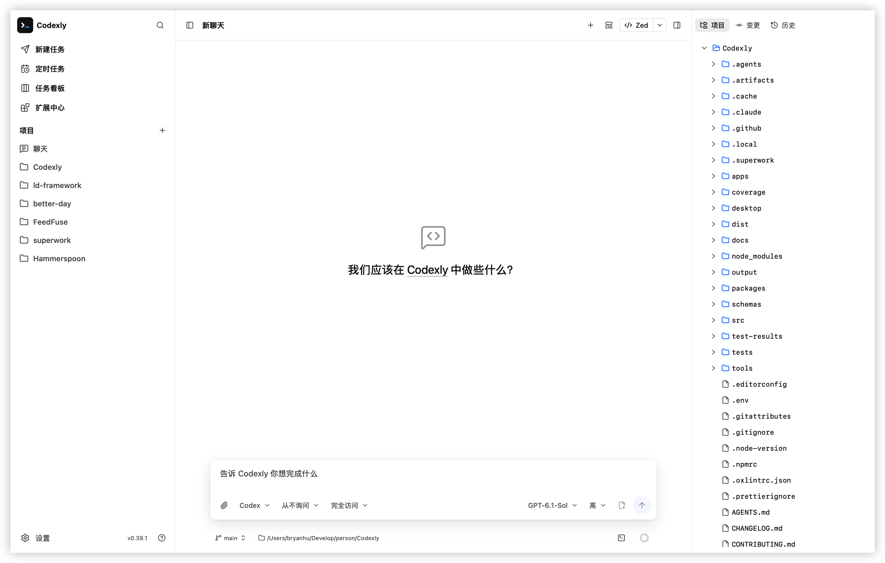

<h1 align="center">Codexly Desktop</h1>

A local AI coding workspace for Codex and Claude on macOS, Windows, and Ubuntu.

[Product overview](../README.en.md) · [Download desktop](https://github.com/BryanHoo/Codexly/releases) · [简体中文](README.md)

## Get started

1. Download the package for your system and architecture; follow [installation](docs/installation.en.md).
2. Configure Codex, Claude, or both in Settings. Supported existing local configurations can be reused.
3. Add a project folder, create a task, and send your request.

Runtimes are bundled, with no separate Node.js, Bun, or CLI installation. Supported platforms are Windows 10/11 x64, Ubuntu 24.04+ x64, macOS 14.5+ on Apple Silicon / Intel, and a separate Codex-only macOS 12.4+ Intel Legacy build.

For Windows portable builds, extract the entire ZIP and keep the executable, Claude host, and `runtime` directory together. Updates replace the complete directory.

## Desktop workspace

Desktop shares conversations, approvals, queues, files, Git, extensions, and scheduled workflows with Web and mobile. It adds a native project terminal, global shortcuts, system notifications, and tray integration. Enable startup at login in **Settings → General**.

User messages can be edited into the current composer and sent as new messages, preserving the original history. The context panel displays available Codex session memory summaries and supports manual refresh. The interface uses system fonts; elapsed-time refresh pauses in the background and recalibrates on return.

Sending focuses the new question and preserves your position while reading. Enable **Sticky messages** and **Message navigation anchors** independently in **Settings → General → Editor**; both default to off. Preview cited web sources and follow or pause output in subagent details. Consecutive commands, tools, and image-view operations share a five-row summary window with complete output in separate detail dialogs.

File diffs expand as individual cards during streaming and move into execution history when the turn ends. Disable **Settings → General → Editor → Show file diffs separately** to restore the end-of-turn summary.

Optimize a nonempty text draft with AI using auxiliary generation settings, then review the result before sending. The Send menu saves project todos or prompts without sending. Ordinary chat can also open its working directory in a host application from the header. Archive, restore, and permanent deletion synchronize with the underlying agent session; generated text from interrupted replies survives task switches and restarts.

Toggle **Show status bar icon** in **Settings → General** to show or hide the system tray icon immediately. The choice persists after restart. Hiding it keeps the app running and preserves the behavior of minimizing to the tray when the window closes.

Open up to four task panes with independent drafts and queues. Files, Git, and the terminal follow the focused task. See [first use](../docs/getting-started.en.md) and the [workspace guide](../docs/usage.en.md).

Drop files or images from your system file manager onto the intended task pane. Attachments belong to that pane and are not sent automatically. Switching between chat and document tabs preserves reading positions. Mermaid diagrams render on demand, without loading diagram support for ordinary conversations.

Switch the sidebar between projects and a timeline, or open the notification center for unread alerts. Tasks visible in foreground panes automatically mark their notifications as read; background tasks keep unread alerts. Reorder, pin, or bulk-close center file tabs and compare files with chat horizontally or vertically. Settings includes global or project saved prompts, inserted by title with `/` or `#`; saved prompts are shared with Web and mobile browsers on the same host, with automatic migration and refresh when a window regains focus.

Create files and folders in the project tree. The text editor provides search and replace, manual saving, unsaved markers, and disk conflict comparison. Closing files or switching projects offers Save, Don’t save, or Cancel. Switching tasks in the same project returns to chat while keeping tabs and drafts. See the [workspace guide](../docs/usage.en.md#files-and-previews).

Marking notifications as read or resolving their requests removes the corresponding system alerts. Reading a notification does not approve an action or answer a question.

Use `⌘/Ctrl+Shift+7/8/9/0` (left, up, down, right) to split tasks and **Help → Keyboard shortcuts** to view available shortcuts. Export a diagnostic ZIP from **Settings → About** when troubleshooting.

The extension center manages local Skills, MCP, and official plugins for Codex or Claude, with search, filters, and global or project scope. Available operations follow each engine's capabilities. Start a new conversation after configuration changes for complete loading.

Desktop and Web under the same OS user on the same computer share projects, tasks, and history in `~/.codexly`. Mobile access needs a separate Web server with LAN enabled; the desktop app does not host it. See [Web and mobile](../docs/web.en.md).

Relative links in file previews open from the current file’s directory, making project documents and Skill references easier to follow. Choose **Open remote repository** from the project quick-open or root directory menu to visit its repository in a browser; the action is disabled when no browsable remote is available.

Choose system, direct, or custom HTTP/HTTPS/SOCKS5 proxy mode in **Settings → Application → Network**, then restart the desktop app or Web server. Configuration is shared on the same host; mobile settings control the server’s outbound connections. See [Network proxy (中文)](../docs/network-proxy.md).

## Documentation and help

- [Installation, updates, and uninstall](docs/installation.en.md)
- [Documentation index](../docs/README.md)
- [FAQ (中文)](../docs/faq.md) · [Diagnostics (中文)](docs/diagnostics.md)
- [Development and builds](docs/development.en.md) · [Runtime distribution (中文)](docs/provider-runtime-management.md)
- [Client and engine capabilities (中文)](docs/codexly-capability-matrix.md)
- [Changelog](../CHANGELOG.md) · [Issues](https://github.com/BryanHoo/Codexly/issues)

## License

[MIT](LICENSE)
